# Actual browser transport review

Written by AI on 2026-10-24 by model GPT-6.

Native browser captures of unaccepted rescue candidates, not final product approval. Map-only views contain no private browser chrome.

- Bridge: 51.9109,4.4848,span280,bearing35,day. Full bridge-actual.jpg is1280×720; bridge-actual-detail.png is a native browser capture of CSS rectangle250,150,350,450 at scale2. The enlarged image resolves the manager's earlier false reading: cars are on grey carriageways and cyclists on orange outer paths. Source/runtime road600728317 also agrees. Do not move correct routes to match that earlier reading.
- Metro phone:390×844, actual reported D position focused through Find at51.9137001,4.481761,span220. Train readable, navigation works; capsule/fins/building intersection still reject the visual presentation.
- Blaak01/06/12: first/middle/last of12.79seconds at51.9184269,4.4845223,span240,bearing125,day,with7source-reviewed turn rules active. Cars traverse the junction; full spacing/conflict/journey quality remains under review.

## Newer source input in the actual runtime

The manager inspected these native browser captures using the newer municipal geometry and its own UVs. Desktop: Delfshaven at 200m span, bearing35; phone: Schiedamseweg at 200m span, bearing125, 390×844. Both settled without pending/refused tiles or loading errors. This is source-integration evidence, not art acceptance: photographic building islands, generic surrounding facades and dominant simple trees remain visibly inconsistent. The tower payload subsequently passed the production host and actual renderer after source-preserving external texture splitting.

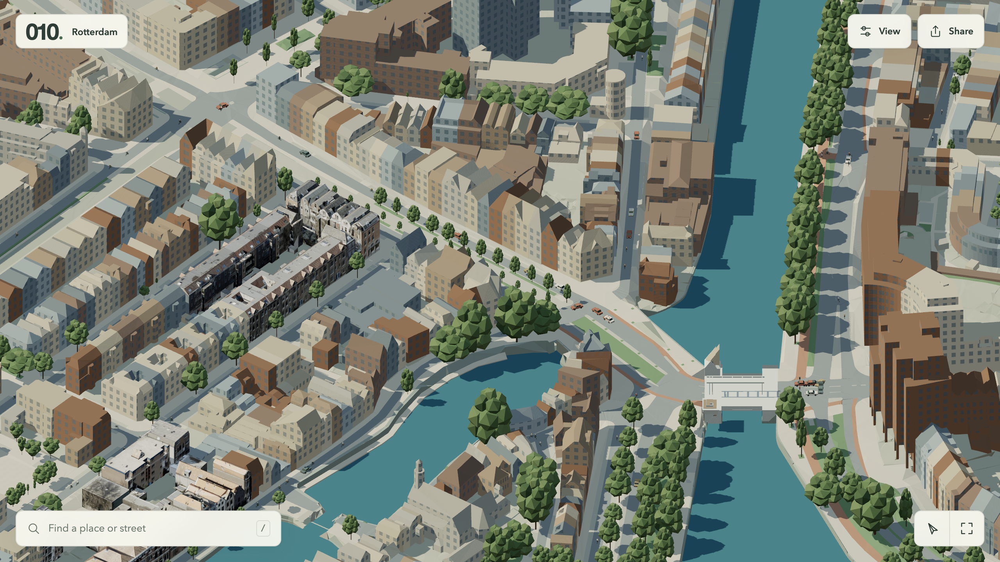

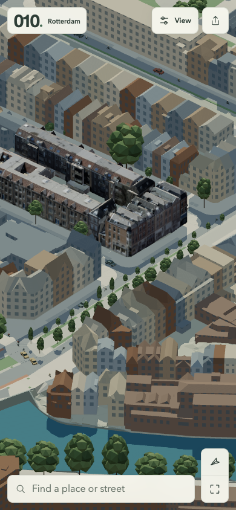

## Metro section without vehicle reports

A native desktop reproduction at51.92514,4.51261,span220,bearing35 shows the black section over apparent rooftops even with no vehicle reports. This interim static server has no API routes; it does not test transit freshness. All22 runtime terrain samples are measured, around−1.48 to−1.06m, with floor−13.48 to−13.06m. The recorded geometry is below ground. This rules out elevated sampled roofs as the cause in this view; clipping/composition remains rejected.

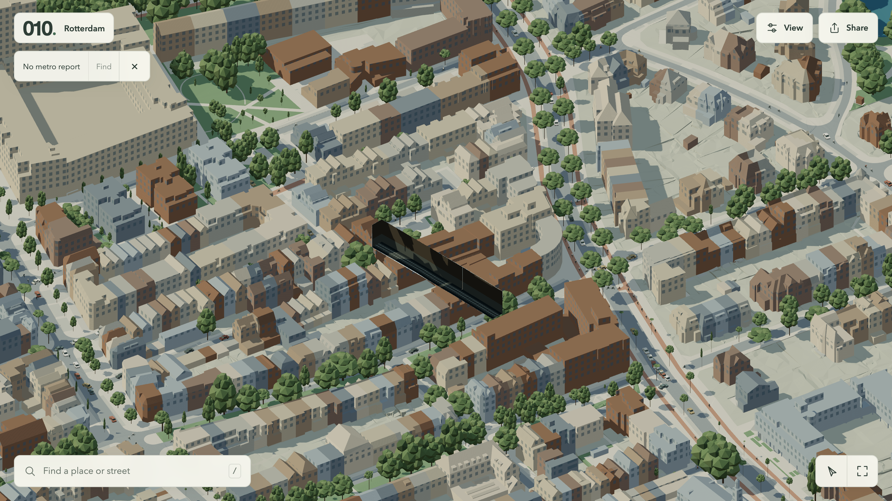

[Actual section diagnostics](metro-static-section-diagnostics.json)

## Persistent junction queue after following-distance change

The manager reviewed17 native frames spanning27.73seconds, then repeated runtime position samples at84.90simulation seconds. Several leading motor vehicles remain at the same positions approaching185274103→600909887; white cars overlap near the queue head. Exact source/vehicle audits accompany the enlarged native capture. One car projects over a surveyed traffic-island polygon while another is over carriageway; do not generalise orange colour to cycle lanes. This is a new bounded failure, separate from the corrected bridge reading.

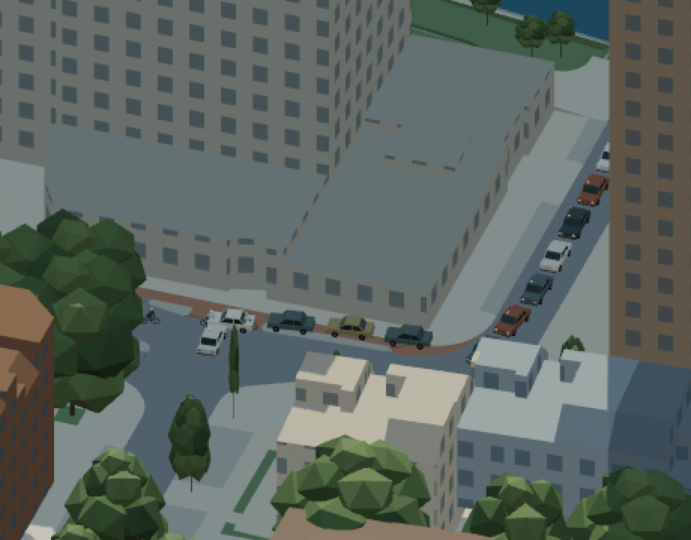

[First vehicle sample](blaak-following-audit-a.json), [repeated sample](blaak-following-audit-b.json), [actual underlying source surfaces](blaak-queue-surface-audit.json).

## Junction reservations and whole-feature metro opening

The newer junction reservation candidate clears the former stopped queue in actual native browser motion review. The retained first/last images span26.7seconds; four intermediate images were also inspected, followed by runtime sampling at78.6simulation seconds. The old car50 now travels a later road at7m/s. This supports queue progress, not full traffic acceptance. The traffic-island placement and broader journey legality remain open.

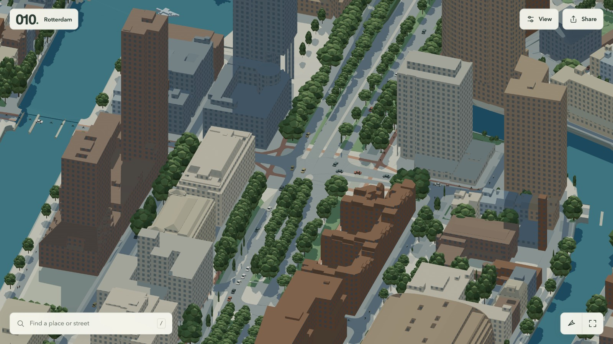

[Runtime vehicle and actual source-surface sample](blaak-reservation-audit.json).

The whole-feature metro candidate removes the worst roof fragments and makes the silver train readable at the same rejected51.92514,4.51261,220m,35degree view. The actual phone still shows an exposed strip with weak earth-boundary composition and distracting source-building outlines. Rotation to80degrees strengthens the floating-strip impression. The report changed during review, so the rotated frame has no observed train; this is not evidence of train movement. Surveyed ground/floor ranges remain correct. Visual acceptance remains open.

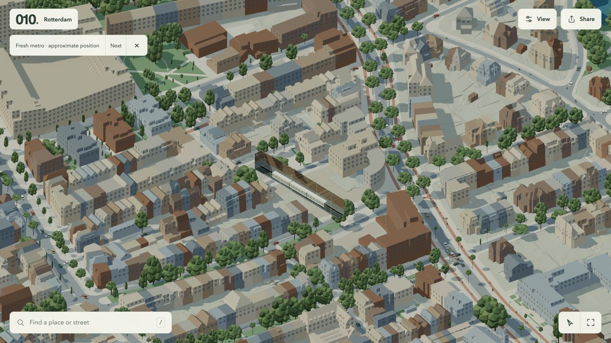

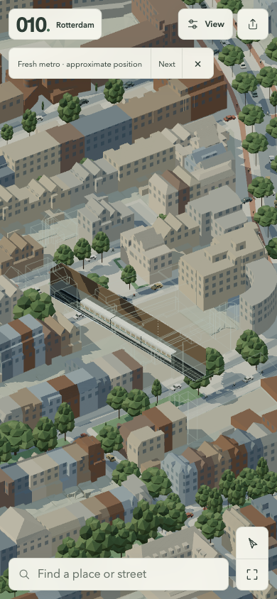

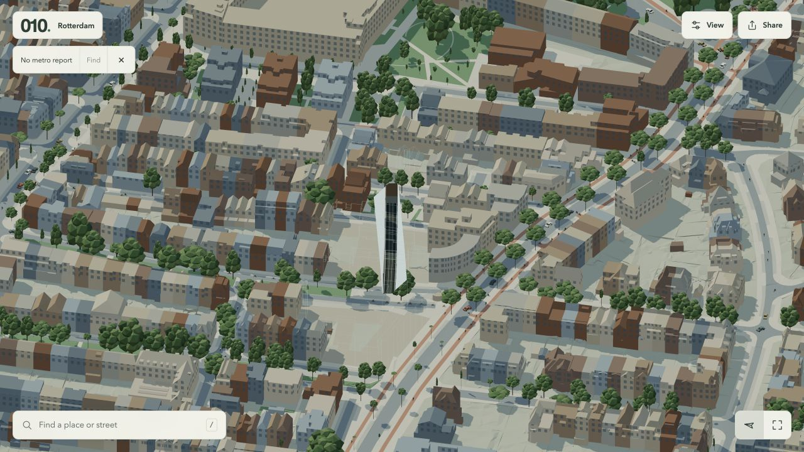

[Actual runtime section and report](metro-whole-features-runtime.json).

## First illustrated row inside the actual city

The manager prepared the delivered original eight-building runtime asset unchanged, rebuilt the candidate and inspected native desktop and390×844 phone at51.90963,4.44711,100m span,35/125degree bearings,day/night. All eight actual source identities render with ground and surrounding fallback, no pending/refused tiles or loading errors. This establishes placement and complete material delivery only.

The row has much richer architectural identity, but remains a photographic-looking island among generic window-grid buildings. Rear surfaces retain projection/photographic artifacts; frontage loses crispness in the runtime compared with the supplied isolated render. Sampling and drawing treatment need separate assessment rather than assuming one cause. New tree crowns have smaller masses yet retain a repetitive clustered plastic appearance. The quieter neutral night palette is a supporting improvement; the illustrated row still lacks lit windows while surrounding fallback windows glow. Source-aligned emission is under independent art work. Bare adjoining street surfaces still fall short. Whole-scene and architectural acceptance remain open.

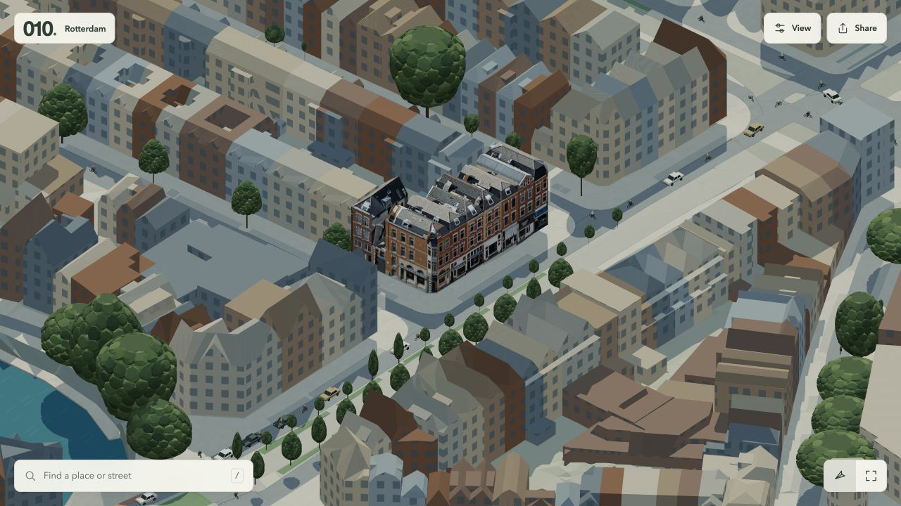

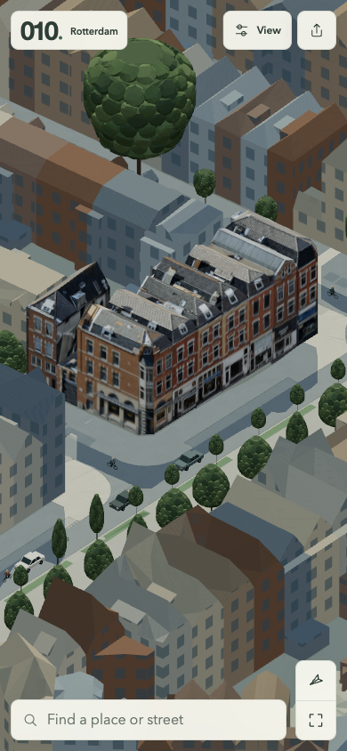

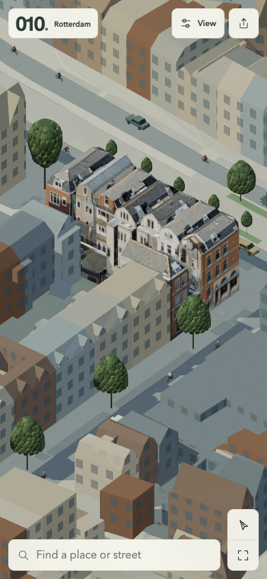

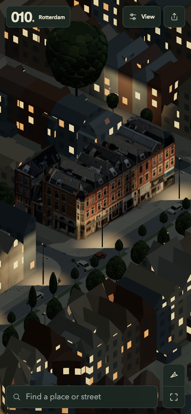

[Exact runtime identities, readiness and appearance state](illustrated-row-runtime-audit.json). The ten unchanged2048² textures use223.7MB decoded including mipmaps. This is not a final performance decision or permission to reduce detail before art quality is established.

Actual c31f83e review, 2026-10-24 (AI, GPT-6): [night desktop](ground-fixture-night-desktop.png), [phone](ground-fixture-night-phone.png), [runtime](ground-fixture-night-runtime.json). Ground now receives source fixture illumination, but broad cream bands/bright facades remain visually flat. Supporting integration, not acceptance.

[Port source desktop](current-port-source-desktop.png), [phone](current-port-source-phone.png), [runtime](current-port-source-runtime.json): fourteen matching OST tanks render; roof seams and ladder markings visible. Source contamination, washed-out texture and coarse triangulated ground remain. Close120m review still selected512px context textures, so native refinement needs investigation. This is source evidence, not illustrated art.

[Metro earth-volume desktop](metro-earth-volume-desktop.png), [phone](metro-earth-volume-phone.png), [runtime](metro-earth-volume-runtime.json): actual Find selected a fresh B report at51.91007,4.44576 with source-compatible approximate track position. Train readable, roof wire cage removed, but long brown vertical slab still reads above the street rather than a convincing excavation. New location because earlier report departed. Pending tiles noted in runtime; repeated settled scene preserves same composition. No new height-cause claim. Still rejected.

Actual afbbf76 controlled sampling review: [baseline](sampling-controlled-phone-baseline.png), [linear control](sampling-controlled-phone-linear.png), [anisotropic8](sampling-controlled-phone-anisotropic.png), [runtime](sampling-controlled-runtime.json). Same source/UVs/art, phone CSS390x844 and actual drawing390x844, span100/bearing125/day, ready with no pending/refused tiles. Linear control appears essentially unchanged under minification; anisotropic8 restores visibly crisper frontage/roof detail. Photographic noise is also sharper. Supporting renderer improvement, not coherent illustrated art acceptance. Baseline restored after review. Desktop/opposing view and moving-camera aliasing remain to check before choosing a default.

Actual combined ground/canopy/metro review (AI, GPT-6, 2026-10-24): [day frontage](combined-day125.png), [opposing night](combined-night35.png), [metro with fresh report](combined-metro-interior-report.png), [empty section](combined-metro-interior-empty.png), [runtime audit](combined-metro-interior-audit.json). Source-aligned paving/markings and observed glazing are useful supporting improvements, with no pending/refused loads. The city still consists mainly of generic window grids and broad flat roof planes. Metro still reads as a tall brown object over the street, despite a fresh source-connected train and correct measured surface/floor data. This rejects its visual composition, not a claim of wrong source height. The detailed row remains a photographic island pending stronger art integration.
