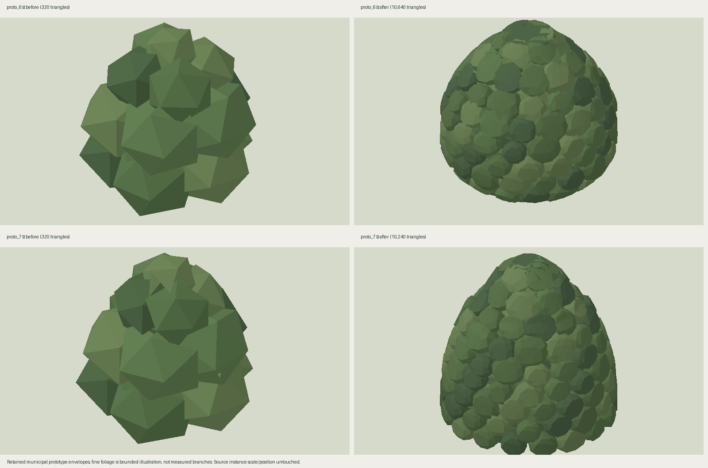
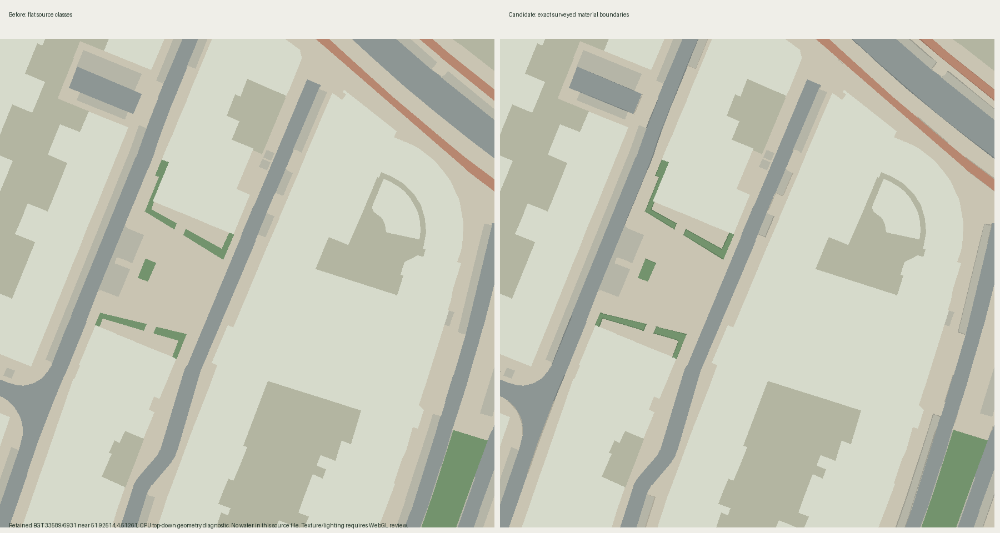

# Source-grounded public-space interpretation candidate

Written by AI, GPT-6, 2026-10-24. **Not visually accepted.** This is a review candidate, not evidence that the whole city meets the rescue brief.

The live [Tiny London source/map comparison](https://tiny.london/how/) was opened and visually inspected, including the actual Westminster roads, crowns, river and bridge. Its roads carry source-visible markings and detailed edges. Its foliage uses many coherent small painted masses rather than giant polyhedra. Its account explicitly warns against content-generating prompts: poorly evidenced regions should remain plain. [NYC's process](https://cannoneyed.com/projects/isometric-nyc) likewise describes special treatment and manual repair of water/trees after the model struggled. These lessons support source reconstruction and replaceable bounded illustration, not adding guessed props to empty areas.

## Exact input evidence

- `source-data/vegetation-style/` retains the municipal tree index, a 344-tree source tile, original unit prototypes and provenance hashes. Crown diameter/height are inventory dimensions. Large crowns are present in source; this stage does not shrink trees to make streets more visible. Branches/leaves are not measured.
- `source-data/transit-ground-evidence/33589-6931.b3dm.gz` retains the native BGT tile near 51.92514, 4.51261, decoded SHA256 `753952e076d0f064c3ffc225d1682b03fe4f7603033d80d6b8ea41d756b009f3`. Inspection of actual attributes found 422 open-paved footpaths, 245 open-paved parking features, 52 open-paved roads, 23 closed-paved roads and 11 closed-paved cycleways. It does not establish brick dimensions, lane paint, pavement furniture or individual parking-space markings. Those are not invented here.
- Existing fixture fields derive from real municipal fixture heads and retained supplementary fixture evidence. Their emission strength remains illustrative. This stage adds no fixture positions or false photometry.

## What changes

`vegetation-style.js` replaces the earlier 16 coarse lobes with overlapping fine foliage masses guided by each original crown's radial profile. Exact prototype envelope and all instance transforms stay intact. A prototype now has roughly 10,000 triangles; current screen-space detail and instancing infrastructure remains independently replaceable. This is still generic inventory-based foliage, not a scanned individual tree.

`public-space-style.js` reads source `FYSIEKVK` into `_surfaceClass`. Unknown/prepared road classes stay unknown instead of being labelled asphalt. Native positions and indices remain exact. For shared triangle edges joining different eligible surveyed surface features, it derives a narrow, matte painted seam inside the source triangle. Internal triangulation, isolated tile boundaries, buildings and unclassified structures do not receive seams. The 10 cm maximum ink width is illustrative, not a claim of measured curbs. Source batch IDs accompany seam triangles so normal ground reconciliation can suppress overlaps.

The material adds subtle, metre-scaled paint grain only to supported surface classes. It integrates out at distant scales. Water has sparse painted wavelets on the existing surveyed water mask; there are no invented wakes, boats, islands or shoreline changes. The wave field is illustration, not observed weather/current. Night reflection still uses the existing scene reflection pass.

`miniature-lighting.js` supplies a continuous neutral night viewing palette, replacing the strongly saturated blue key/hemisphere. Local fixture lighting remains independent. This is a viewing-light interpretation, not a measured sky model; actual-night acceptance must check streets remain legible.

## Root integration hooks

This worker deliberately does not edit `scene.js` or `miniature-style.js`.

1. Import `applyPublicSpaceMaterial, createPublicSpaceStyle` from `./public-space-style.js` and `applyMiniatureLighting` from `./miniature-lighting.js`.
2. Apply `applyPublicSpaceMaterial` once to ground, streets, bridgeSurfaces, greenTerrain, industrialTerrain, yards, cartographicMaterial and contextLandMaterial. These must be materials made by `createCityMaterial` (they supply cityWorldPosition/cityHash). Apply after material creation; it composes with lighting/cutaway wrappers.
3. After the existing cutaway and fixture wrappers have been attached, instantiate `const publicSpaceStyle=createPublicSpaceStyle({material: materials.ground})`. The border material clones its source callbacks/default attributes and polygon-offsets only its narrow coplanar seams. Do not attach cutaway a second time.
4. At the end of `colorModel`, after original mesh colour assignment and before `bindCutawayShadows`, call `publicSpaceStyle.addModel(model)` for ground/streets/bridgeSurfaces/greenTerrain/industrialTerrain/yards. This must precede `sourceFusion.addGround(model)`, so seams participate in the existing reconciliation. Do not add seams to buildings/bridges/trees.
5. For those layer `dispose-model` callbacks call `publicSpaceStyle.removeModel(event.scene)`. Add dispose/diagnostics along with other style owners.
6. In `setLighting`, replace the existing sun/sky/background colour+intensity assignments with `applyMiniatureLighting({sun,sky,background:scene.background},{night,golden,cloud})`. Keep solar direction, shadows, weather and fixture fields as-is.

## Reproduce and review

Run `node tests/public-space-style.test.mjs` and `node tests/vegetation-style.test.mjs`. Run `python scripts/render-public-space-review.py` with the primary runtime Python (NumPy, Pillow, pyproj). It reads original retained bytes, exports actual candidate geometry through Node and renders CPU comparisons. The baseline crown implementation is pinned to git commit `8ea60494c9ae362db750df3cfbef6dbd5f57679d`.

These diagnostics show geometry and source semantics only. They do not test the final WebGL shaders, source shadows, complete building composition, phone performance or actual night rendering. Ground seam changes are deliberately restrained; they do **not** supply missing lane paint or solve the whole-scene fidelity gap by themselves. Next source work must acquire georeferenced, source-visible street detail and interpret it coherently with the model-painted buildings, without displaying raw aerial photographs or burning moving vehicles/shadows into the terrain. Manager review must compare bridge, ordinary streets, neighbourhood and port at close/wide day/night scales before enabling this candidate for delivery.
