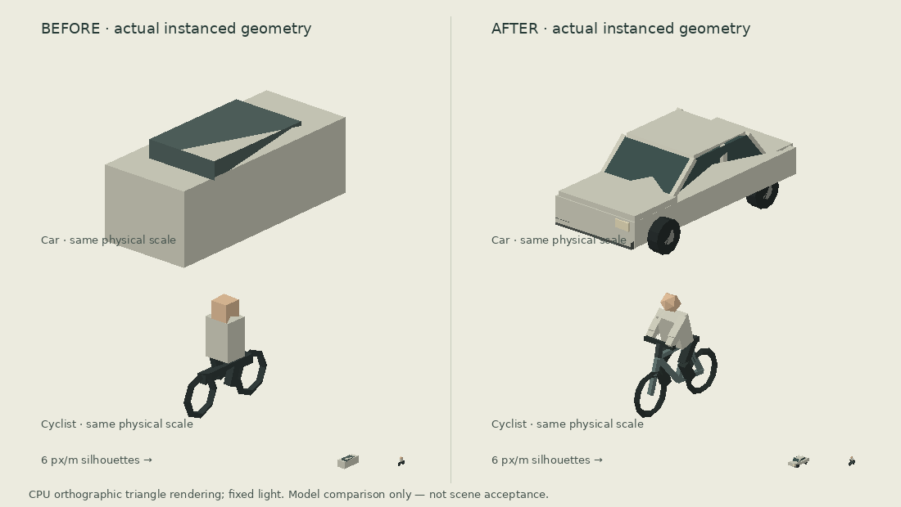

# Instanced traffic models

Cars now use a low painted body with hood/trunk, a sloped glazed cabin, painted roof/pillars, four tyres/hubs and restrained front/rear lamps. Full envelope including trim is 4.30 × 1.885 × 1.47 metres. Cyclists use a diamond frame, fork, saddle, handlebars, two wheels, a leaning torso/arms and bent pedalling legs. These are generic illustrations; vehicle makes, rider identity and hardware are not surveyed evidence. The muted existing fleet palette is unchanged.

Car geometry is shared across three instanced draws; bicycle geometry across five. Material detail uses vertex colours in one batch, with no textures, individual lights or per-vehicle meshes. Shadows remain on the painted body. Road positions, speeds, source topology, fixed journeys, lane offsets, fade lifecycle and elevation projection are unchanged. No giant scaling is introduced at close zoom.

This comparison transforms the actual instanced geometry from the old/new traffic modules and software-renders its triangles at identical scale and light direction. The enlarged cyclist comparison uses the same scale on both sides. Bottom silhouettes use 6 pixels/metre. CPU painter sorting is approximate and can leave small triangle seams; this is a shape/silhouette review, **not WebGL material, scene alignment or phone acceptance**. Manager scene review remains required.

Validation: `node tests/traffic-models.test.mjs` checks geometry bounds, finite buffers and outward cabin faces; `node tests/traffic-motion.test.mjs`, `node tests/traffic-journeys.test.mjs` and `node tests/cycling-access-network.test.mjs` preserve source/motion checks. The runtime draws are bounded regardless of fleet count. The shared module is `public/traffic-models.js`; simulation integration remains in `public/simulated-traffic.js`.
