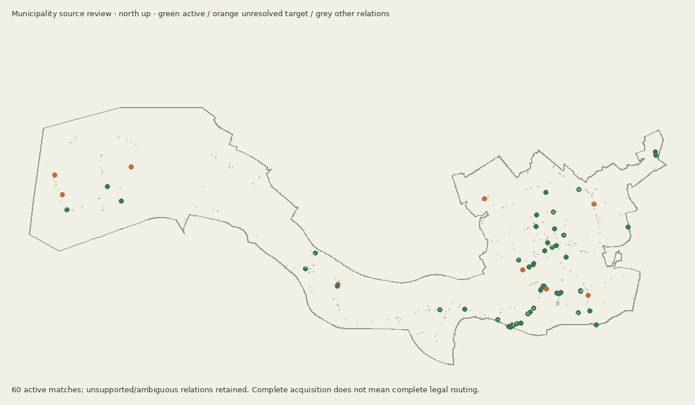

# Municipality turn source review

The complete acquisition contains 620 in-boundary OSM restriction relations. Geometry matching produces 155 candidates; 70 meet the strict 2m junction / .985 tangent / exact-name-or-proven-continuation gates. Source overlays were inspected for all 70. An explicit frozen review selects 60 whose directed target movements exist in the retained runtime graph. They prohibit 51 currently available directed transitions (41 additional transitions beyond the ten-rule pilot). Ten only-turn rules currently have no extra effect because their required movement is already the sole exit.



[Source overlay sheet 1](images/traffic-municipality-matches-1.png) · [2](images/traffic-municipality-matches-2.png) · [3](images/traffic-municipality-matches-3.png) · [4](images/traffic-municipality-matches-4.png)

## Semantics and limits

The OSM [restriction schema](https://wiki.openstreetmap.org/wiki/Relation:restriction) was checked on 2026-10-24. Motorcar-specific tags take precedence over motor_vehicle, vehicle and generic restrictions. Exceptions are parsed as semicolon-separated modes. A bicycle exception does not exempt a motorcar; moped/psv/emergency exceptions are not ordinary-car exceptions. No rules are transferred to the WKD bicycle network. The retained source includes one bus/hgv-only relation, three conditional relations and 28 via-way or multi-member relations: these remain inactive. Conditions require temporal evaluation; via-way restrictions require path state, not a guessed single junction.

Ten strict matches remain inactive because their directed target is already absent in the current graph: seven U-turn restrictions and three other turns. This reports existing graph behaviour, not an assertion that all real U-turns are illegal. The planner rejects unresolved only-turn targets or contradictory rules instead of silently eliminating all exits. Tests verify every selected required target remains reachable after restriction application.

Acquisition completeness means all planned source tiles were retrieved, not legal-routing completeness. 255 relations lack a unique nearby NWB junction and 178 fail unique name/direction/tangent matching; all remain inspectable in the audit. Signal timing, right of way, conditional restrictions and via-way rules are not implemented. This source review does not establish native motion or visual acceptance. The Blaak surface/island alignment question is separate.

## Active reviewed movements

NWB directions below are original H/T/B source values followed by runtime traversal (+1 forward / -1 reverse). Newly prohibited counts compare the graph without these rules to the graph with all 60; zero means an already sole allowed exit.

| OSM relation | Restriction | From NWB / source direction / traversal | Via NWB | To NWB / source direction / traversal | Street evidence | Exceptions | Newly prohibited |
|---|---|---|---|---|---|---|---|
| [1251642](https://www.openstreetmap.org/relation/1251642) | only_straight_on | 601084245 / H / +1 | 600412445 | 601084253 / H / +1 | Maastunnelplein → Maastunnelplein | none | 1 |
| [1251663](https://www.openstreetmap.org/relation/1251663) | only_straight_on | 601083986 / H / +1 | 600412332 | 601083992 / H / +1 | Doklaan → Doklaan | none | 0 |
| [1251664](https://www.openstreetmap.org/relation/1251664) | only_straight_on | 601083992 / H / +1 | 600412329 | 601083976 / H / +1 | Doklaan → Doklaan | none | 1 |
| [1251665](https://www.openstreetmap.org/relation/1251665) | only_straight_on | 601083979 / H / +1 | 184268226 | 601083982 / H / +1 | Doklaan → Brielselaan | none | 0 |
| [1309215](https://www.openstreetmap.org/relation/1309215) | no_right_turn | 183265092 / H / +1 | 183265100 | 601017322 / H / +1 | Groene Kruisweg → Oldegaarde | none | 1 |
| [1312594](https://www.openstreetmap.org/relation/1312594) | only_straight_on | 601214659 / H / +1 | 600476512 | 601214660 / H / +1 | Nassaukade → Stieltjesstraat | none | 1 |
| [2376966](https://www.openstreetmap.org/relation/2376966) | only_straight_on | 181272058 / B / +1 | 181272035 | 601723658 / H / +1 | Nieuwe Binnenweg → Nieuwe Binnenweg | none | 1 |
| [3295651](https://www.openstreetmap.org/relation/3295651) | only_straight_on | 600107418 / H / +1 | 178263098 | 600480988 / H / +1 | Reeweg → Reeweg | none | 1 |
| [4063857](https://www.openstreetmap.org/relation/4063857) | only_straight_on | 601722926 / H / +1 | 185274231 | 601723271 / H / +1 | Blaak → Blaak | none | 2 |
| [4188413](https://www.openstreetmap.org/relation/4188413) | only_straight_on | 600931270 / B / +1 | 124280002 | 600710138 / B / +1 | Missouriweg → Missouriweg | none | 1 |
| [4225827](https://www.openstreetmap.org/relation/4225827) | only_straight_on | 601079462 / H / +1 | 600410251 | 601079473 / H / +1 | Schieweg → Schieweg | none | 1 |
| [5250821](https://www.openstreetmap.org/relation/5250821) | no_left_turn | 189282014 / B / +1 | 189282035 | 600731400 / B / +1 | Molenlaan → Van Beethovenlaan | none | 1 |
| [5486771](https://www.openstreetmap.org/relation/5486771) | no_left_turn | 601110148 / H / +1 | 184267120 | 184267138 / B / +1 | Dorpsweg → Katendrechtse Lagedijk | none | 1 |
| [5486860](https://www.openstreetmap.org/relation/5486860) | only_straight_on | 601085559 / H / +1 | 182264047 | 601085556 / H / +1 | Groene Kruisweg → Groene Kruisweg | none | 1 |
| [6772594](https://www.openstreetmap.org/relation/6772594) | no_right_turn | 600910067 / H / +1 | 196276103 | 601244275 / H / +1 | Prins Alexanderlaan → Kralingseweg | none | 1 |
| [8761489](https://www.openstreetmap.org/relation/8761489) | no_left_turn | 189267201 / H / +1 | 189267244 | 600361609 / H / +1 | Breeplein → Breeplein | none | 1 |
| [8761492](https://www.openstreetmap.org/relation/8761492) | only_straight_on | 601074945 / H / +1 | 189267240 | 189267201 / H / +1 | Breeplein → Breeplein | none | 1 |
| [8839096](https://www.openstreetmap.org/relation/8839096) | no_left_turn | 601110388 / H / +1 | 191264070 | 191264071 / B / -1 | Spinozaweg → Catullusweg | none | 1 |
| [9626131](https://www.openstreetmap.org/relation/9626131) | only_straight_on | 600264959 / H / +1 | 600074647 | 600907982 / H / +1 | Boezemlaan → Gordelweg | none | 1 |
| [10014720](https://www.openstreetmap.org/relation/10014720) | only_straight_on | 181263034 / H / +1 | 181263102 | 600725595 / H / +1 | Groene Kruisweg → Groene Kruisweg | none | 1 |
| [10626156](https://www.openstreetmap.org/relation/10626156) | no_left_turn | 600447614 / H / +1 | 600121185 | 600447607 / H / +1 | Victor Hugoweg → Spinozaweg | none | 1 |
| [11231184](https://www.openstreetmap.org/relation/11231184) | only_straight_on | 186274186 / H / +1 | 186274256 | 600729096 / H / +1 | Blaak → Blaak | none | 1 |
| [11605330](https://www.openstreetmap.org/relation/11605330) | no_left_turn | 191263027 / B / +1 | 192262006 | 600732808 / B / -1 | Kooiwalweg → Jacob Vrijstraat | bicycle | 1 |
| [11758547](https://www.openstreetmap.org/relation/11758547) | no_right_turn | 601249162 / H / +1 | 183271076 | 601078581 / H / +1 | Westzeedijk → Droogleever Fortuynplein | none | 1 |
| [11783357](https://www.openstreetmap.org/relation/11783357) | no_left_turn | 600995603 / H / +1 | 600376106 | 600995615 / H / +1 | Boezemweg → Gerdesiaweg | none | 1 |
| [11866083](https://www.openstreetmap.org/relation/11866083) | only_straight_on | 184281018 / B / +1 | 184281025 | 601115503 / B / +1 | Ringdijk → Ringdijk | none | 0 |
| [11880453](https://www.openstreetmap.org/relation/11880453) | only_right_turn | 184268111 / H / +1 | 184268115 | 601084034 / H / +1 | Brielselaan → Brielselaan | none | 1 |
| [12611381](https://www.openstreetmap.org/relation/12611381) | only_straight_on | 600944639 / H / +1 | 179262023 | 179262007 / H / +1 | Groene Kruisweg → Groene Kruisweg | none | 1 |
| [12611382](https://www.openstreetmap.org/relation/12611382) | only_straight_on | 600104791 / H / +1 | 179262018 | 600106895 / H / +1 | Groene Kruisweg → Groene Kruisweg | none | 0 |
| [12611383](https://www.openstreetmap.org/relation/12611383) | only_straight_on | 600392652 / H / +1 | 180263011 | 600104792 / H / +1 | Groene Kruisweg → Groene Kruisweg | none | 1 |
| [12611384](https://www.openstreetmap.org/relation/12611384) | only_straight_on | 180262006 / H / +1 | 180262014 | 180262008 / H / +1 | Groene Kruisweg → Groene Kruisweg | none | 0 |
| [13187813](https://www.openstreetmap.org/relation/13187813) | no_left_turn | 182264057 / H / +1 | 182264102 | 182264071 / H / +1 | Slinge → Groene Kruisweg | none | 1 |
| [13284675](https://www.openstreetmap.org/relation/13284675) | no_right_turn | 601536358 / H / +1 | 600396420 | 601048405 / H / +1 | Amoerweg → Amoerweg | none | 1 |
| [13284676](https://www.openstreetmap.org/relation/13284676) | no_right_turn | 600198613 / H / +1 | 116279025 | 116279027 / H / +1 | Amoerweg → Amoerweg | none | 1 |
| [13651594](https://www.openstreetmap.org/relation/13651594) | no_left_turn | 601226086 / H / +1 | 600483134 | 601226088 / H / +1 | Pieter de Hoochweg → Westzeedijk | none | 1 |
| [13774733](https://www.openstreetmap.org/relation/13774733) | only_right_turn | 184273077 / B / -1 | 184273051 | 600909852 / H / +1 | Kromme Elleboog → Boomgaardsstraat | none | 0 |
| [14230460](https://www.openstreetmap.org/relation/14230460) | only_right_turn | 200287063 / B / -1 | 200287040 | 600736982 / H / +1 | Beatrice Woodstraat → Laan van Dada | none | 0 |
| [14230781](https://www.openstreetmap.org/relation/14230781) | only_straight_on | 600736968 / B / -1 | 200287004 | 200287032 / B / -1 | Wollefoppenweg → Wollefoppenweg | none | 1 |
| [14654566](https://www.openstreetmap.org/relation/14654566) | only_straight_on | 180263017 / H / +1 | 181263098 | 181263034 / H / +1 | Groene Kruisweg → Groene Kruisweg | none | 1 |
| [14654567](https://www.openstreetmap.org/relation/14654567) | only_straight_on | 601084564 / H / +1 | 600412556 | 601084565 / H / +1 | Groene Kruisweg → Groene Kruisweg | none | 1 |
| [14966194](https://www.openstreetmap.org/relation/14966194) | no_left_turn | 601724275 / B / +1 | 185274202 | 185274167 / B / -1 | Coolsingel → Aert van Nesstraat | none | 1 |
| [14966195](https://www.openstreetmap.org/relation/14966195) | no_left_turn | 601044903 / B / -1 | 185274202 | 601300569 / B / +1 | Coolsingel → Meent | none | 1 |
| [14966196](https://www.openstreetmap.org/relation/14966196) | no_right_turn | 185274167 / B / +1 | 185274202 | 601724275 / B / -1 | Aert van Nesstraat → Coolsingel | none | 1 |
| [15328106](https://www.openstreetmap.org/relation/15328106) | only_straight_on | 173265005 / H / +1 | 173265027 | 173265006 / H / +1 | Vondelingenweg → Vondelingenweg | none | 1 |
| [15599443](https://www.openstreetmap.org/relation/15599443) | no_right_turn | 601074918 / H / +1 | 189267243 | 600909993 / H / +1 | Breeweg → Randweg | none | 1 |
| [16778058](https://www.openstreetmap.org/relation/16778058) | only_right_turn | 600361199 / B / -1 | 186267135 | 601240797 / H / +1 | Zuidplein → Zuidplein | none | 0 |
| [17428899](https://www.openstreetmap.org/relation/17428899) | no_left_turn | 601249161 / B / +1 | 600409346 | 601077591 / H / +1 | Westzeedijk → G.J. de Jonghweg | none | 1 |
| [17886893](https://www.openstreetmap.org/relation/17886893) | only_straight_on | 183278146 / H / +1 | 183278204 | 600727066 / H / +1 | Gordelweg → Gordelweg | none | 1 |
| [18290512](https://www.openstreetmap.org/relation/18290512) | only_straight_on | 600108100 / H / +1 | 155268017 | 600108102 / H / +1 | Botlekweg → Botlekweg | none | 1 |
| [18919618](https://www.openstreetmap.org/relation/18919618) | only_straight_on | 151273019 / H / +1 | 151273039 | 601058239 / H / +1 | Nieuwe weg → Nieuwe weg | none | 1 |
| [18990384](https://www.openstreetmap.org/relation/18990384) | only_right_turn | 601116660 / B / +1 | 186276180 | 601214699 / H / +1 | Noorderbrug → Jonker Fransstraat | moped, psv, emergency | 1 |
| [19204457](https://www.openstreetmap.org/relation/19204457) | only_straight_on | 183265091 / H / +1 | 183265063 | 600726942 / H / +1 | Groene Kruisweg → Groene Kruisweg | none | 1 |
| [19262426](https://www.openstreetmap.org/relation/19262426) | only_straight_on | 601078032 / H / +1 | 186267247 | 600115046 / H / +1 | Strevelsweg → Strevelsweg | none | 1 |
| [19262553](https://www.openstreetmap.org/relation/19262553) | only_straight_on | 600891426 / H / +1 | 187267143 | 600111886 / H / +1 | Strevelsweg → Strevelsweg | none | 1 |
| [19358541](https://www.openstreetmap.org/relation/19358541) | no_left_turn | 601078660 / H / +1 | 183271168 | 601249161 / B / +1 | G.J. de Jonghweg → Westzeedijk | none | 1 |
| [20804238](https://www.openstreetmap.org/relation/20804238) | no_right_turn | 600930065 / H / +1 | 122282057 | 600930068 / H / +1 | Europaweg → Dardanellenstraat | none | 1 |
| [20804239](https://www.openstreetmap.org/relation/20804239) | no_right_turn | 600930112 / H / +1 | 122282061 | 600930113 / H / +1 | Europaweg → Coloradoweg | none | 1 |
| [21376084](https://www.openstreetmap.org/relation/21376084) | only_straight_on | 601057847 / H / +1 | 600400416 | 601057833 / B / +1 | Merseyweg → Merseyweg | none | 0 |
| [21376085](https://www.openstreetmap.org/relation/21376085) | only_straight_on | 601057833 / B / -1 | 600400416 | 601057844 / H / +1 | Merseyweg → Merseyweg | none | 0 |
| [21411051](https://www.openstreetmap.org/relation/21411051) | no_right_turn | 600480782 / H / +1 | 169265011 | 600480779 / H / +1 | Vondelingenweg → Vondelingenweg | none | 1 |

## Reproduce

Run the municipality audit with the retained source and acquisition manifest, inspect overlays, then explicitly renew the frozen review hash/IDs if source or audit changes. The compiler refuses an unaudited refresh.

```sh
python scripts/audit-turn-restrictions.py --source source-data/traffic/osm-municipality-turn-restrictions.json.gz --acquisition source-data/traffic/osm-municipality-turn-acquisition.json --output source-data/traffic/osm-municipality-turn-audit.json
python scripts/render-turn-source-review.py --municipality
python scripts/compile-turn-restrictions.py
node scripts/audit-turn-runtime.mjs > source-data/traffic/osm-municipality-turn-runtime-audit.json
node tests/traffic-restrictions.test.mjs
```

The audit includes its generation timestamp, so rerunning it intentionally invalidates the review hash until reviewed again. Raw acquisition, NWB, audit and runtime provenance hashes remain retained.
