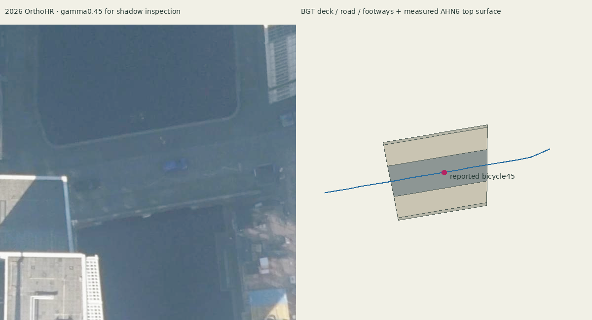

# Soetensteeg missing deck: source review

The reported crossing is a missing physical bridge surface, not evidence of an invalid bicycle route. At bicycle 45's reported longitude 4.483014458, latitude 51.919168681, runtime found only Waterdeel DGDT16445890 at local Y −1.234913 while the bicycle base was Y 3.6335268. NWB road 185274065 (Soetensteeg, RB, direction H, July 2026 source) crosses this exact location. BRT object 117054515 explicitly identifies a fixed bridge carrying mixed traffic.

The retained untextured municipal bridge catalogue has no content at this location (nearest content approximately 688 m away). The alternate textured catalogue's covering child also contains no bridge here. The retained native ground tile 33584/6932 contains water, not a deck, at the probe even before height filtering. Moving the network would conceal an omitted model.

## Retained evidence and bounded reconstruction

`source-data/traffic/soetensteeg-bridge/` retains catalogue responses, BGT responses and their request URLs, the original 2026 OrthoHR crop, AHN6 point subset, source metadata, hashes and the build review. BGT was queried at 2026-10-24. Deck G0599.16fd01700ee0ccac9e050210a7e24119 is registered as an existing raised deck, covering 204.3555 m². Three raised wegdeel polygons distinguish a carriageway (79.9980 m²) and two footways (52.3989 and 58.5888 m²). The remaining 13.3699 m² is rendered as unclassified deck-edge paving; no access designation is invented.

AHN6's 2026 delivery contains the bounded 12,319-point subset. Points over this deck have December 2025 acquisition GPS times; this is not a claim that the LiDAR flight occurred in 2026. The deck interior contains 2,501 observed class-26 surface points and eight class-1 points. Separate robust quadratic fits to the carriageway and footways preserve their different heights. Fit RMS residuals are 0.0189 m for the carriageway, 0.0185/0.0205 m for the footways, and 0.0300 m for the remaining deck edge. Deck median is approximately 3.747 m NAP; carriageway median is approximately 3.708 m. Numerical NAP heights use the project's existing Earth-height convention, rather than claiming an independently corrected geoid transformation.

The generated GLB contains 638 triangles and four semantic surfaces. It reconstructs measured top surfaces only: no unsupported arches, railings or underside. The original aerial is retained unchanged; the review sheet applies a labelled gamma adjustment only to inspect shadowed source evidence.



## Route and renderer integration

`surface-profiles.json` adds samples at no more than two-metre intervals along road 185274065's original NWB segments. All original vertices, endpoints, directions, access and junction IDs remain unchanged. Both motor and bicycle layers apply the same source-guarded sampling before elevation projection. This is necessary because the original three vertices straddle the canal and do not sample the interior deck. It does not relocate a route or apply the separate Blaak motor correction to bicycles.

Scene integration must load `data/supplemental-bridge-surfaces/tileset.json` as an additional `bridgeSurfaces` layer and include every visible layer of that kind when assembling surface queries. Existing prepared bridge surfaces must remain loaded. This source commit does not change scene.js; the integrating worker owns that change.

## Rebuild and checks

From the repository root, with Python dependencies `numpy`, `shapely`, `pyproj`, `Pillow`, and `laspy[lazrs]` installed:

```sh
python scripts/build-soetensteeg-bridge.py
python tests/soetensteeg-bridge.test.py
node tests/traffic-geometry.test.mjs
node tests/traffic-motion.test.mjs
node tests/traffic-junctions.test.mjs
npm run build
```

The rebuild is offline and reads retained sources. In the cloud environment the extra laspy installation was under `/tmp/010-ahn-deps`, so the builder ran with `PYTHONPATH=/tmp/010-ahn-deps`.

Checks passed: actual generated GLB has a road hit between 3.5 and 4 m at the reported probe; all four surface fits have residuals below 5 cm; the densified path remains within 2 cm of the rounded original source line and preserves its vertices; both traffic modes load the height profile while bicycle geometry remains isolated from the Blaak motor patch; actual Blaak queue regression and general traffic checks pass; production build passes. These establish source/geometry behavior, not native visual acceptance. The manager still needs to inspect the loaded deck, vehicle clearance and continuing journeys in the actual browser.
